<div align="center">


<br>
<sub><a href="https://devault.design/ascii-art-generator/">ascii art</a>, not ai art.</sub>


</div>

<table align="center">
<tr>
<td valign="middle" align="center">

</td>
<td valign="middle">

```text
suryaanshs007@arch
------------------
OS        macOS + Arch Linux ARM (UTM)
Host      MacBook Air M4
WM        Hyprland
Bar       Waybar
Terminal  foot
Editor    Neovim (LazyVim)
Launcher  rofi
Shell     zsh
```

</td>
</tr>
</table>

<div align="center">


</div>

### `~ ❯ ls ~/stack`


### `~ ❯ ls ~/projects --sort=impact`

<details open>
<summary><code>Purple-Rain/</code> &nbsp;·&nbsp; lua &nbsp;·&nbsp; hyprland dotfiles</summary>
<br>

```text
My own dotfiles for Arch Linux (Hyprland), built on a silicon Mac.
Beautiful and blazingly fast.
```

<a href="https://github.com/suryaanshs007/Purple-Rain"></a>


</details>

<details>
<summary><code>Java-Transactions-Processor/</code> &nbsp;·&nbsp; java</summary>
<br>

```text
Java transactions processing engine.
```

<a href="https://github.com/suryaanshs007/Java-Transactions-Processor"></a>


</details>

<details>
<summary><code>cloudIntelligence/</code> &nbsp;·&nbsp; jupyter</summary>
<br>

```text
Tech Solstice cloud intelligence software.
```

<a href="https://github.com/suryaanshs007/cloudIntelligence"></a>


</details>

<details>
<summary><code>odin-recipes/</code> &nbsp;·&nbsp; html</summary>
<br>

```text
The recipes project from The Odin Project's web development course.
```

<a href="https://github.com/suryaanshs007/odin-recipes"></a>


</details>

### `~ ❯ git log --graph --all`

<div align="center">


</div>

### `~ ❯ ping suryaanshs007`

<a href="https://www.linkedin.com/in/suryaansh-s-16455836a/"></a>
<a href="https://github.com/suryaanshs007"></a>

<br><br>

<p align="center"></p>
